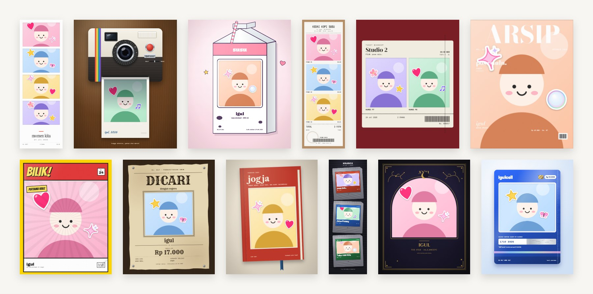
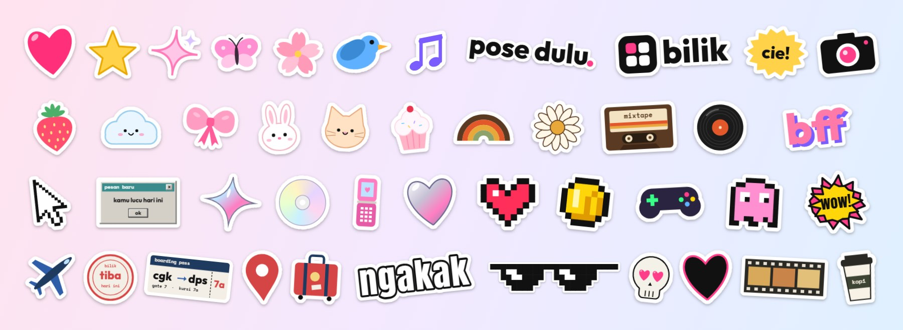

<div align="center">

# bilik

### pose dulu.

**photobox di browser.** pilih template, jepret, tempel stiker, langsung jadi.<br>
tanpa aplikasi, tanpa akun, dan fotomu tidak pernah keluar dari perangkatmu.


**[buka bilik →](https://bilik-beta.vercel.app)**

[fitur](#-fitur) · [tangkapan layar](#-tangkapan-layar) · [coba jalankan](#-coba-jalankan) · [di balik layar](#-di-balik-layar) · [privasi](#-privasi)

<br>



</div>

<br>

## ✦ kenapa bilik?

Photobox di mal itu seru, tapi antre, bayar, dan cuma dapat satu lembar. **bilik** memindahkan pengalaman itu ke browser: buka di HP atau laptop, pilih gaya, pose, dan hasilnya siap diunduh, dibagikan, atau dicetak.

| | |
| --- | --- |
| 🎞️ **145 template** | 12 kategori, dari strip klasik sampai voucher pulsa dan kartrid game |
| 💖 **stiker wajah langsung** | hati, bintang, burung, kupu-kupu, dan lainnya mengikuti wajahmu di kamera, sampai 3 orang sekaligus |
| ✂️ **164 stiker tempel** | stiker gaya vinyl per kategori, plus tulisan sendiri dalam 6 gaya |
| 🔁 **boomerang** | rekam burst singkat jadi GIF bolak-balik |
| 🖨️ **siap cetak** | ekspor png, story 9:16, atau langsung cetak ukuran 4R |
| 📱 **HP & desktop** | dirancang untuk layar sentuh dan mouse, bisa dipasang sebagai aplikasi (PWA) |

<br>

## ✦ tangkapan layar



<br>

## ✦ fitur

<details open>
<summary><b>template untuk semua suasana</b></summary>

`klasik` · `retro` · `cute` · `kalcer` · `bestie` · `editorial` · `bold & pop` · `meme` · `travel` · `gaming` · `dark` · `y2k`

- tiap template digambar ulang ke canvas dari desain HTML aslinya, jadi tajam di semua ukuran
- nama, tanggal, tempat, dan warna aksen bisa diganti sebelum memotret
- tulisan "jakarta → bali" otomatis jadi rute di tiket pesawat

</details>

<details open>
<summary><b>kamera, filter & lensa</b></summary>

- filter warna, "kulit halus", lensa, dan timer 3/5/10 detik
- stiker wajah langsung yang mengikuti wajah di kamera, sampai 3 orang sekaligus
- boomerang: rekam burst singkat jadi GIF bolak-balik

</details>

<details open>
<summary><b>stiker yang terasa seperti stiker sungguhan</b></summary>

- **pinggiran putih die-cut** dihitung dari bentuk stikernya, jadi rapi di ujung yang lancip sekalipun
- **cubit dua jari** untuk ukuran & putaran di HP; scroll dan shift+scroll di desktop
- **urungkan, gandakan, cerminkan, ke depan/belakang**, lengkap dengan pintasan keyboard
- **tab kategori mengikuti template**: pakai template gaming, yang muncul duluan stiker piksel

</details>

<details open>
<summary><b>hasil & mode booth</b></summary>

- ekspor png, story 9:16, atau langsung cetak ukuran 4R
- **mode booth** untuk acara: layar kiosk dengan nama acara, kembali ke awal sendiri. Buka `/?booth` atau tekan lama logo bilik untuk masuk setelan acara

</details>

<br>

## ✦ coba jalankan

Cara paling cepat: buka **[bilik-beta.vercel.app](https://bilik-beta.vercel.app)**. Untuk menjalankan di komputer sendiri:

```bash
git clone https://github.com/masigoooel/Bilik.git
cd Bilik
npm install
npm run dev   # http://localhost:5173
```

| perintah | gunanya |
| --- | --- |
| `npm run dev` | mode development |
| `npm run dev:host` | buka dari HP di jaringan yang sama (kamera butuh https atau localhost) |
| `npm run build` | cek tipe + build produksi ke `dist/` |
| `npm run preview` | jalankan hasil build secara lokal |
| `npm run design:compare` | bandingkan template canvas dengan desain HTML-nya |

<br>

## ✦ di balik layar

| bagian | teknologi |
| --- | --- |
| framework | React 19 + TypeScript + Vite 8 |
| styling | Tailwind CSS v4 |
| kamera & efek | WebGL untuk lensa, Canvas untuk filter, template, dan stiker |
| deteksi wajah | MediaPipe Face Landmarker di Web Worker |
| offline | service worker (PWA) |
| backend | tidak ada |

- frame kamera lewat lensa **WebGL**, lalu filter, lalu lapisan stiker di atasnya. Stiker tidak ikut terkena filter warna
- deteksi wajah berjalan di **Web Worker**, jadi preview tetap mulus walau di HP kelas menengah
- **service worker** menyimpan aset untuk dipakai offline. Model wajah (3.7 MB) baru diunduh saat stiker wajah dipakai

<details>
<summary><b>struktur folder</b></summary>

```
src/
├─ screens/     alur aplikasi: beranda → jumlah foto → template → isi teks → kamera → hasil
├─ camera/      kamera, burst, deteksi wajah (Web Worker), pemilih efek
├─ render/      pipeline frame (crop → lensa WebGL → filter → stiker) & penggambar template
├─ templates/   145 template per kategori, digambar ke canvas
├─ effects/     stiker wajah (sprite ber-cache supaya ringan di HP)
├─ lib/         foto, boomerang, stiker tempel, cetak, perangkat
└─ components/  tombol, editor stiker, dan komponen bersama
```

</details>

<br>

## ✦ privasi

> Tidak ada server yang menerima fotomu. Semuanya terjadi di browser.

- kamera, filter, template, dan stiker diproses **sepenuhnya di perangkat**
- deteksi wajah memakai **MediaPipe Face Landmarker** di Web Worker. Titik wajah hanya dipakai untuk menempatkan stiker dan **tidak disimpan**
- tidak ada akun, pelacak, atau iklan

<br>

## ✦ catatan & kredit

- kamera butuh **https** atau **localhost**, jadi kalau dibuka dari HP lewat alamat IP biasa, kameranya tidak akan menyala
- model wajah `public/models/face_landmarker.task` & `@mediapipe/tasks-vision`: [Google MediaPipe](https://ai.google.dev/edge/mediapipe), Apache License 2.0
- font lewat [Fontsource](https://fontsource.org): Outfit, Space Mono, DM Serif Display, Caveat, VT323, Anton (SIL Open Font License)

<br>

<div align="center">

**bilik** · dibuat dengan ♥ oleh [@masigoooel](https://github.com/masigoooel)

</div>
